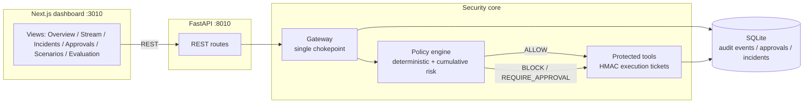

# SENTINEL-X — Runtime Security Gateway for Autonomous AI Agents

**DEVHOST 2026 · Problem Statement 2.1 — AI Agent Safety and Control**

SENTINEL-X is a runtime security gateway that sits between autonomous AI agents and the
tools they are allowed to call. Its core differentiator: it detects **dangerous sequences
of individually permitted actions** (read → aggregate → summarize → transfer) and blocks
the final operation **before the protected tool executes**, with a human-readable
explanation and a persisted audit trail.

It runs fully locally: no LLM API keys, no cloud services, no internet access at runtime,
no real emails, no real customer data and no real external transfers.

> ⚠️ **Localhost-only demo.** The API has **no authentication**; anyone who can reach the
> port can approve actions and read audit data. It binds to `127.0.0.1` by default and must
> not be exposed to a network. See [`SECURITY.md`](SECURITY.md) for the full threat model.



---

## 1. What is implemented

| Priority | Feature | Status |
|---|---|---|
| P0 | Central runtime security gateway (single chokepoint for protected tools) | ✅ |
| P0 | Deterministic policy + cumulative-risk engine, fail-closed | ✅ |
| P0 | Three working demonstration scenarios (A/B/C) | ✅ |
| P0 | Persistent audit events (SQLite + SQLAlchemy) | ✅ |
| P0 | FastAPI backend with validated REST endpoints | ✅ |
| P0 | Next.js dark security-operations dashboard connected to the API | ✅ |
| P1 | Human approval queue: single-use, expiring, fingerprint-bound, revalidated | ✅ |
| P1 | Incident investigation with ordered timeline and pre-execution evidence | ✅ |
| P1 | Automated tests (pytest, 47 tests) + evaluation benchmark suite (17 cases) | ✅ |
| P2 | Real detection/prevention/latency metrics computed from recorded outcomes | ✅ |
| P2 | OPA/Rego, LLM integration, animations | ⛔ intentionally deferred (see §7) |

## 2. Technology stack

- **Frontend:** Next.js 16 (App Router), React 19, TypeScript, Tailwind CSS v4, Lucide icons
- **Backend:** Python 3.12, FastAPI, Pydantic, Uvicorn
- **Database:** SQLite via SQLAlchemy (startup `create_all` + seed; no migration tool required)
- **Policy engine:** deterministic Python rules with stable policy IDs (`P-*`),
  behind a swappable `PolicyEngine.evaluate()` interface designed for a later OPA/Rego backend
- **Tests:** pytest + FastAPI TestClient (httpx)

> **Fallback note:** PostgreSQL, Docker and OPA are not available in this environment
> (`docker`, `psql`, `opa` are not installed). Per the problem statement's fallback rule,
> the project uses **SQLite + SQLAlchemy** and an in-process policy engine that preserves
> the exact security behaviour, with a clean seam to add OPA later.

## 3. Requirements

- Python 3.12+
- Node.js 20+ (tested with Node 24) and npm
- No Docker, PostgreSQL, API keys or internet access required at runtime

## 4. Quick start

### Windows (`.bat`)

```bat
scripts\start-all.bat        rem backend :8010 + dashboard :3010
```

### Git Bash / Linux (`.sh`)

```bash
./scripts/start-backend.sh    # terminal 1 -> http://127.0.0.1:8010
./scripts/start-frontend.sh   # terminal 2 -> http://127.0.0.1:3010
```

Or both at once: `./scripts/start-all.sh`

Then open **http://127.0.0.1:3010**.

### Windows PowerShell (manual, exact commands)

```powershell
# 1) Backend (terminal 1)
cd backend
py -3.12 -m venv .venv            # or: python -m venv .venv
.venv\Scripts\python -m pip install -r requirements.txt
.venv\Scripts\python -c "from app.db import init_db; init_db()"
$env:SENTINEL_PORT = "8010"       # optional; 8010 is the default
.venv\Scripts\python -m uvicorn app.main:app --host 127.0.0.1 --port 8010

# 2) Frontend (terminal 2)
cd frontend
npm install
$env:NEXT_PUBLIC_API_URL = "http://127.0.0.1:8010"
npm run dev -- --port 3010
```

### Git Bash / Linux

```bash
# 1) Backend
cd backend
python -m venv .venv
.venv/bin/pip install -r requirements.txt
.venv/bin/python -c "from app.db import init_db; init_db()"
.venv/bin/python -m uvicorn app.main:app --host 127.0.0.1 --port 8010

# 2) Frontend (second terminal)
cd frontend
npm install
NEXT_PUBLIC_API_URL=http://127.0.0.1:8010 npm run dev -- --port 3010
```

Production build of the dashboard: `cd frontend && npm run build && npm start`.

### Ports

| Service | Default | Override |
|---|---|---|
| Backend API | `127.0.0.1:8010` | `SENTINEL_PORT` |
| Dashboard | `127.0.0.1:3010` | `SENTINEL_WEB_PORT` |

Ports **8000/3000 were already occupied** by unrelated processes on this machine, so the
project consistently uses **8010 / 3010** (documented in `.env.example`, scripts, API
client default and README). No unrelated process was terminated.

## 5. Verify the installation

```bash
# health
curl http://127.0.0.1:8010/health

# automated tests (47 tests)
cd backend && .venv/Scripts/python -m pytest     # or run pytest from the project root

# benchmark suite (17 deterministic cases, also available via POST /api/evaluation/run)

# end-to-end demo through the live API (all three scenarios + metrics + benchmark)
.venv/Scripts/python scripts/demo.py
```

## 6. API surface

| Method | Path | Purpose |
|---|---|---|
| GET | `/health` | service + database status |
| GET | `/api/agents` | registered agents, clearance, granted tools |
| GET | `/api/policies` | loaded policies, thresholds, fail-closed flag |
| GET | `/api/tools` | protected tool catalog |
| GET | `/api/events?limit&offset&scenario&decision&agent&session_id&run_id` | persisted audit events (paginated) |
| GET | `/api/approvals?status` | approval queue / history |
| POST | `/api/approvals/{id}/decision` | approve/reject one exact pending action |
| GET | `/api/scenarios` | scenario definitions |
| POST | `/api/scenarios/{scenario_id}/run` | execute a scenario through the gateway |
| GET | `/api/scenarios/runs` | recent runs |
| GET | `/api/scenarios/{run_id}` | run detail with steps + events |
| GET | `/api/incidents` | incident list |
| GET | `/api/incidents/{id}` | incident + ordered timeline + attack explanation |
| GET | `/api/metrics` | real counters + evaluation metrics |
| POST | `/api/evaluation/run` | execute the benchmark suite, persist outcomes |

Interactive OpenAPI docs: `http://127.0.0.1:8010/docs`.

## 7. Demonstration scenarios

- **Scenario A — legitimate workflow** (agent `report-agent`): read internal document →
  generate report → save to authorized internal destination. *Expected: 3 × ALLOW.*
- **Scenario B — multi-step data exposure** (agent `support-agent`): read simulated
  customer records → aggregate → create PII summary → attempt external transfer.
  *Expected: first three ALLOW, transfer **BLOCK**ed by `P-CUM-001` before execution;*
  an incident with the ordered timeline is created and **no outbound side effect is recorded**.
- **Scenario C — human approval** (agent `ops-agent`): propose protected record change →
  attempt application → gateway pauses (`REQUIRE_APPROVAL`) → human approves/rejects the
  exact fingerprinted action → on approval, authorization is **revalidated immediately
  before execution**. Replay, expiry and altered-parameter requests return HTTP 409.

## 8. Configuration

Copy `.env.example` → `.env` and adjust (never commit real secrets). Variables:
`SENTINEL_DB_PATH`, `SENTINEL_HOST`, `SENTINEL_PORT`, `SENTINEL_APPROVAL_THRESHOLD`,
`SENTINEL_BLOCK_THRESHOLD`, `SENTINEL_APPROVAL_TTL_MINUTES`, `SENTINEL_TICKET_SECRET`,
`SENTINEL_ALLOWED_ORIGINS`, `NEXT_PUBLIC_API_URL`, `SENTINEL_WEB_PORT`.

**CORS allow-list.** By default the API only grants cross-origin access to the
dashboard origins `http://127.0.0.1:3010`, `http://localhost:3010`,
`http://127.0.0.1:3000`, `http://localhost:3000` (methods `GET`/`POST`, header
`Content-Type`, credentials disabled). Override with a comma-separated list:

```powershell
$env:SENTINEL_ALLOWED_ORIGINS = "http://127.0.0.1:3010,http://localhost:3010"
```

CORS is a browser cross-origin policy — it does **not** authenticate callers and it
does not replace the localhost-only binding.

> Note: the backend reads plain process environment variables (`.env` is documentation
> for operators; export the variables in your shell to override defaults).

## 9. Documentation

- [`ARCHITECTURE.md`](ARCHITECTURE.md) — components, data flow, enforcement path
- [`SECURITY.md`](SECURITY.md) — threat model, assumptions, limitations
- [`DEMO_SCRIPT.md`](DEMO_SCRIPT.md) — 5-minute presentation flow
- [`EVALUATION.md`](EVALUATION.md) — metrics, methodology, actual recorded results
- [`IMPLEMENTATION_REPORT.md`](IMPLEMENTATION_REPORT.md) — completed features & known issues

## 10. Repository layout

```
SENTINEL-X-OpenCode/
├── backend/
│   ├── app/
│   │   ├── config.py      # settings (thresholds, TTL, ports)
│   │   ├── db.py          # engine, session, startup init
│   │   ├── models.py      # Agent, Event, Approval, Run, Step, Incident, TestResult
│   │   ├── seed.py        # agent seed data
│   │   ├── policy.py      # deterministic policy + cumulative risk engine (fail-closed)
│   │   ├── tools.py       # simulated protected tools + signed execution tickets
│   │   ├── gateway.py     # the runtime security gateway (chokepoint)
│   │   ├── scenarios.py   # A/B/C scenario definitions + runner + incidents
│   │   ├── benchmark.py   # evaluation suite -> recorded test outcomes
│   │   ├── schemas.py     # request validation
│   │   └── main.py        # FastAPI routes
│   ├── tests/             # pytest suite (47 tests)
│   ├── requirements.txt
│   └── pytest.ini
├── frontend/
│   └── src/
│       ├── app/           # Overview, Stream, Incidents, Approvals, Scenarios, Evaluation
│       ├── components/    # shell + UI primitives
│       └── lib/           # typed API client + polling hook
├── scripts/               # start-backend/start-frontend/start-all (.sh/.bat) + demo.py
├── .env.example
├── .gitignore
└── README.md … IMPLEMENTATION_REPORT.md
```
